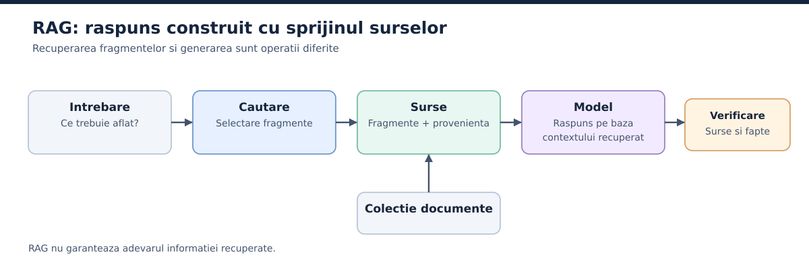

# 8. Cunostinte externe, memorie si RAG

## 8.1. De ce avem nevoie de informatii din afara modelului

Un model poate explica principiile contabilitatii, dar nu cunoaste facturile unei firme anume. Poate descrie un limbaj de programare, dar fara acces nu stie cum arata ultima versiune a codului tau. Sa-i repeti manual toate documentele la fiecare cerere e obositor, iar daca vrei sa bagi o arhiva intreaga, poti depasi contextul sau poti strica relevanta.

Solutia este sa pastrezi documentele intr-un sistem separat si sa aduci doar fragmentele necesare. Familia asta de metode se numeste **RAG**, de la *Retrieval-Augmented Generation*. Lucrarea de referinta a lui Lewis si a colegilor, din 2020, a descris combinarea generarii cu recuperarea de informatie dintr-o memorie externa [S08](../anexe/bibliografie.md#s08). De atunci, termenul acopera multe implementari practice, nu doar arhitectura exacta din articolul original.

## 8.2. RAG in cinci pasi

1. Ai o colectie de documente sau inregistrari, de exemplu regulile unei firme.
2. Sistemul le pregateste pentru cautare: extrage textul, il imparte in fragmente, retine metadate si, eventual, calculeaza reprezentari numerice.
3. Utilizatorul pune o intrebare, de pilda "Care este termenul de retur pentru produsul X?".
4. Sistemul cauta fragmentele relevante si le trimite modelului impreuna cu intrebarea.
5. Modelul redacteaza raspunsul pe baza materialului recuperat, de preferat cu indicarea sursei.

*Figura 1. RAG: colectie de documente, recuperare si raspuns cu surse. Cautarea poate fi vectoriala, dupa cuvinte-cheie sau mixta.*

Un **embedding** este o reprezentare numerica a continutului, utila in unele sisteme de cautare semantica. O **baza vectoriala** poate pastra astfel de reprezentari si cauta vecinii cei mai apropiati. RAG nu cere insa obligatoriu o baza vectoriala: cautarea dupa cuvinte-cheie, SQL sau o combinatie pot fi suficiente, uneori chiar mai potrivite.

## 8.3. Ce poate merge prost intr-un RAG

Recuperarea gresita e una dintre cele mai greu de observat probleme. Daca intrebi despre politica de retur din 2026 si sistemul aduce politica din 2023, modelul poate scrie un raspuns elegant, dar depasit. Daca fragmentele sunt prea mici, se pierde contextul. Daca sunt prea mari, cautarea devine mai putin precisa. Daca informatia nu exista, modelul trebuie sa poata spune ca sursele nu ajung.

RAG nu elimina halucinatiile si nu face credibila o sursa care nu e. O pagina web poate contine informatii false, iar documentele recuperate pot contine chiar instructiuni rauvoitoare. De aceea calitatea recuperarii, calitatea raspunsului si securitatea surselor sunt trei evaluari separate [S09](../anexe/bibliografie.md#s09).

## 8.4. Ce inseamna memoria unui agent

**Memoria de lucru** e informatia din contextul curent: obiective, rezultate recente, pasi in curs. **Memoria persistenta** e informatia salvata intre rulari: preferinte, decizii confirmate, rezumate de proiect, fapte cu surse. **Memoria episodica** poate descrie rularile anterioare, iar **memoria semantica** poate aduna cunostinte despre domeniu. Termenii sunt utili, dar implementarea poate fi mult mai simpla: fisiere, baze SQL, un registru de decizii sau un motor de cautare.

O nota scrisa automat nu e un fapt verificat. Daca agentul retine din greseala ca un proiect foloseste versiunea 3 a unei biblioteci, cand de fapt foloseste versiunea 2, eroarea se poate propaga la fiecare sarcina urmatoare. De aceea informatiile persistente trebuie sa pastreze sursa, data, domeniul de valabilitate si, unde e cazul, statutul de confirmare.

## 8.5. Cine actualizeaza memoria si cand?

Un mecanism simplu salveaza la finalul sarcinii doar deciziile aprobate si faptele verificate. Informatiile temporare, presupunerile si incercarile esuate raman in jurnal, dar nu devin automat reguli permanente. La proiectele lungi, memoria poate avea niveluri: reguli generale, decizii ale proiectului, starea unei rulari si documente recuperabile.

**Stergerea si expirarea** fac parte din design. Unele informatii sunt valabile pana la urmatoarea factura, pana la schimbarea unei versiuni sau pana la o anumita data. O memorie buna stie nu doar ce sa pastreze, ci si cand sa nu se mai bazeze pe ceva vechi.

## 8.6. RAG si memoria nu sunt acelasi lucru

RAG este o **metoda de a recupera informatie pentru generare**. Memoria spune **ce informatie se pastreaza si cum supravietuieste de la o sarcina la alta**. Poti folosi RAG peste o biblioteca de manuale fara sa ai memorie personala. Poti avea memorie persistenta intr-o baza SQL fara sa folosesti RAG. Adesea se combina, dar fiecare are alta responsabilitate.

## 8.7. Cum masori un sistem RAG

Un RAG poate gresi in doua locuri diferite, iar daca masori doar raspunsul final nu vei sti in care. Prima greseala: sistemul aduce fragmentele nepotrivite sau incomplete. A doua: fragmentele sunt bune, dar modelul scrie ceva ce ele nu sustin. Sunt probleme cu cauze diferite si cu remedii diferite.

Lucrarea RAGAS (Es, James, Espinosa Anke si Schockaert, prezentata la EACL 2024) propune evaluarea fara referinte scrise de om pe trei dimensiuni: cat de bine gaseste sistemul pasajele relevante, cat de fidel le foloseste modelul si cat de buna e generarea in sine [S27](../anexe/bibliografie.md#s27). Documentatia actuala a bibliotecii foloseste nume de metrici pe care le vei intalni in practica: *Context Precision*, *Context Recall*, *Faithfulness* si *Response Relevancy* [S27](../anexe/bibliografie.md#s27). Numele difera putin fata de cele din lucrare, asa ca verifica intotdeauna definitia din versiunea de documentatie pe care o folosesti.

O regula practica: porneste cu un set mic de intrebari reale (30-50 sunt un inceput rezonabil), adauga pentru fiecare fragmentul care ar trebui sa fie gasit si raspunsul asteptat, apoi masoara separat recuperarea si raspunsul. Metricile calculate de un alt model sunt un ajutor, nu o hotarare finala. Un judecator automat poate gresi, deci verifica manual un esantion din cazurile semnalate.

## 8.8. Cand RAG-ul simplu nu ajunge

RAG-ul obisnuit se descurca bine la intrebari precum "Care e termenul de retur pentru produsul X?", pentru ca raspunsul sta intr-unul sau doua fragmente. Se impiedica la intrebari globale: "Care sunt temele principale din toate rapoartele noastre de anul trecut?". Niciun fragment singur nu contine raspunsul, iar cautarea dupa similaritate aduce doar cateva bucati.

Pentru astfel de cazuri, Edge si colegii au propus *GraphRAG*: sistemul extrage entitati si relatii din documente, le grupeaza in comunitati, scrie rezumate pentru fiecare grup si le foloseste la intrebari care privesc intreaga colectie [S26](../anexe/bibliografie.md#s26). Costul e real, pentru ca indexarea cere multe apeluri la model. Alege o astfel de abordare doar dupa ce ai observat, pe cazuri reale, ca recuperarea simpla nu raspunde la intrebarile utilizatorilor tai.

Pana atunci, o varianta ieftina e combinarea cautarii dupa cuvinte-cheie cu cea semantica si adaugarea de metadate (data, versiune, tip de document) pentru filtrare. Nu e spectaculos, dar rezolva multe dintre problemele din sectiunea 8.3.

## 8.9. Provenienta, versiunea si expirarea cunostintelor

O baza de cunostinte nu e doar o colectie de raspunsuri reutilizabile. Fiecare afirmatie importanta ar trebui sa indice sursa originala, data consultarii, versiunea relevanta si statutul verificarii. Principiul apare si in ghidurile practice pentru construirea unei baze personale de cunostinte tehnice: separi sursa, interpretarea si experimentul [S21](../anexe/bibliografie.md#s21).

Sa zicem ca pastrezi regula "clientii pot returna produsele in 30 de zile". Intre timp, firma schimba politica la 14 zile pentru o categorie. Daca agentul recupereaza nota veche fara data, poate scrie un raspuns perfect formulat, dar gresit. Remediul nu e un prompt mai autoritar. Ai nevoie de o sursa oficiala, de actualizare, de identificarea versiunii si de eliminarea sau marcarea ca expirate a fragmentelor vechi.

Acelasi principiu se aplica documentatiei software, preturilor, procedurilor interne si notelor de cercetare. Un rezultat de test se pastreaza impreuna cu mediul in care a fost obtinut. "A mers" nu ajunge daca nu mai stii ce versiune, ce fisiere sau ce configuratie ai folosit.

## 8.10. Un flux de cunoastere cu aprobare

Intr-un sistem robust, agentul poate propune o noua nota de memorie, dar o regula sau un responsabil verifica daca nota e un fapt, o preferinta, o ipoteza sau doar un rezultat temporar. O concluzie neverificata nu devine regula generala pentru toate rularile viitoare. Nici datele sensibile nu se pastreaza "pentru orice eventualitate".

Un ciclu simplu: *sursa identificata, extras verificabil, interpretare marcata, validare, stocare cu versiune, reevaluare la expirare*. Este acelasi reflex pe care il ai la un jurnal tehnic bine tinut, aplicat memoriei unui sistem AI.
