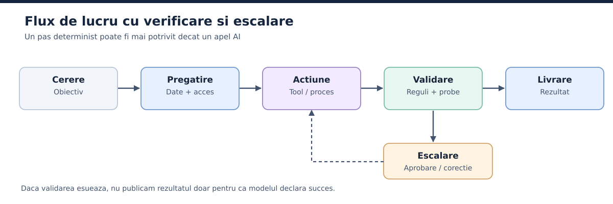

# 11. Arhitectura de referinta: straturile unui workflow AI

Figura 4 arata fluxul general, de la cerere pana la actiune sau escaladare. Observa ca nu fiecare casuta are nevoie de un model.

*Figura 4. Flux generic cu verificari si cale de escalare. Nu orice etapa are nevoie de un model AI.*

## 11.1. De ce vorbim despre straturi

Cand o aplicatie creste, nu mai poti trata totul ca pe un singur prompt. Apar surse diferite, utilizatori cu permisiuni diferite, sarcini care dureaza, intreruperi, documente, unelte, alerte si aprobari. Ca sa intelegi sistemul, il imparti pe responsabilitati. **Straturile** sunt o metoda de analiza, nu opt sau zece servere obligatorii. Intr-un prototip pot rula in acelasi program, iar intr-o organizatie mare pot fi servicii separate. Figura 5 aseaza cele opt straturi, numerotate ca sectiunile 11.2 pana la 11.9, plus responsabilitatile transversale din sectiunea 11.10.

*Figura 5. Straturile sunt responsabilitati logice, nu servere obligatorii.*

## 11.2. Stratul de intrare

Primeste cererea. Poate fi un mesaj intr-un chat, o actiune intr-o aplicatie, un email, un eveniment de monitorizare sau un apel API. Aici afli cine e utilizatorul, ce a cerut, in ce limba vrea raspunsul si daca cererea include fisiere. Inainte de orice inferenta e rezonabil sa faci verificari elementare: dimensiunea fisierelor, tipul continutului, autentificarea, autorizarea si datele lipsa.

Nu orice intrare trebuie trimisa unui LLM. Daca soseste un eveniment "backup finalizat", o regula clasica poate actualiza starea fara model. AI-ul intervine cand natura informatiei sau a deciziei o justifica.

## 11.3. Stratul de interpretare si pregatire

Transforma cererea intr-o descriere operationala: obiectiv, intrari, iesiri, reguli si nivel de risc. De exemplu, "verifica platile restante" poate cere stabilirea perioadei si identificarea bazei de date. Daca lipseste informatia esentiala, sistemul poate intreba utilizatorul in loc sa inventeze. In alte cazuri poate aplica valori implicite aprobate.

Aici pot lucra validatoare clasice, un clasificator sau un model de limbaj. Rezultatul ar trebui sa fie o structura clara, nu un paragraf vag pe care alte componente trebuie sa il ghiceasca.

## 11.4. Stratul de orchestrare si stare

Orchestratorul primeste sarcina pregatita si hotaraste cum se proceseaza. Poate alege un singur agent, poate porni un workflow fix, poate imparti problema intre specialisti si poate astepta terminarea dependentelor. Mai important, **tine adevarul operational**: ce s-a cerut, ce e in lucru, cine raspunde, ce versiune a unui rezultat e aprobata si ce conditii au blocat executia.

Un orchestrator care spune doar "delegat cu succes", fara identificatori de sarcini, rezultate si stari verificabile, nu ofera nicio garantie. Starea trebuie sa traiasca intr-o sursa controlata de aplicatie, nu doar intr-un rezumat din conversatie.

## 11.5. Stratul modelelor si agentilor

Aici se executa cererile de generare si deciziile asistate de model. Agentii pot avea roluri diferite, dar toti respecta contractele stabilite de arhitectura. Un specialist in cercetare poate avea acces la cautare si documentatie; unul de dezvoltare poate folosi fisiere si teste; un evaluator poate inspecta rezultate fara sa modifice implementarea.

Rolurile se separa cand difera responsabilitatile, uneltele, criteriile de acceptare sau nivelurile de risc. Nu ai nevoie de un agent nou pentru fiecare comanda de terminal.

## 11.6. Stratul de actiune si integrare

Aici se executa efectiv operatiile: interogari SQL, citirea sau scrierea fisierelor, cautare web, apeluri catre sisteme de gestiune, build-uri sau notificari. Uneltele trebuie sa valideze argumentele, sa impuna drepturile de acces si sa returneze coduri de rezultat precise. Daca o actiune a esuat, modelul nu trebuie sa poata transforma esecul in succes prin felul in care formuleaza raspunsul final.

Pentru operatiile cu efecte secundare, stratul de integrare trebuie sa sustina, unde se poate, **idempotenta**: repetarea aceleiasi cereri sa nu dubleze efectul. Un identificator unic al unei plati, de exemplu, poate preveni trimiterea tranzactiei de doua ori dupa o eroare de retea.

## 11.7. Stratul de cunostinte si memorie

Documentele, registrele, bazele de date si deciziile confirmate se pastreaza intr-o forma administrabila. Unele date se recupereaza prin RAG, altele prin interogari structurate. Memoria de proiect are alta durata de viata decat contextul unei sarcini. Nu orice conversatie merita arhivata pentru totdeauna si nu orice rezumat merita sa devina regula.

Conteaza sursele, versiunile, accesul si politicile de pastrare a datelor. Un sistem care recupereaza dintr-o arhiva invechita poate genera erori constante, chiar daca modelul si orchestratorul merg impecabil.

## 11.8. Stratul de verificare si control

Compara actiunile si rezultatele cu criterii independente. Poate verifica schema unui JSON, suma unei facturi, rezultatul unei suite de teste sau conformitatea unei operatii cu permisiunile aprobate. Pentru decizii complexe poate folosi un evaluator AI si poate cere verificare umana. Un evaluator AI nu e insa o instanta magica a adevarului: verdictul lui trebuie calibrat si verificat.

Limitele cu efect juridic, financiar sau de securitate trebuie aplicate de cod si infrastructura. O cerere de confirmare scrisa intr-un prompt nu echivaleaza cu blocarea efectiva a functiei `send_payment` pana la aprobarea unui operator autorizat.

## 11.9. Stratul de observabilitate si imbunatatire

Jurnalele si trace-urile descriu ce s-a intamplat, cand si cu ce rezultat. Metricile aduna durata, costul, rata de succes, frecventa erorilor si numarul de interventii umane. Datele astea ajuta la investigarea incidentelor si la compararea versiunilor. Conventiile semantice OpenTelemetry pentru AI generativ acopera operatii de inferenta, recuperare si apeluri de unelte, dar au statutul "Development", deci se pot schimba, iar sistemele concrete pot avea implementari diferite [S12](../anexe/bibliografie.md#s12).

Aici trebuie sa deosebesti **pastrarea datelor pentru diagnostic** de **folosirea datelor pentru a imbunatati un model**. A doua poate presupune evaluari, modificari de prompt, unelte noi sau antrenare separata. Nu se intampla automat doar pentru ca ai conectat un registru de loguri.

## 11.10. Responsabilitati transversale

Securitatea, confidentialitatea, administrarea identitatilor, auditul, costurile si disponibilitatea nu apartin unui singur strat. Ele strabat toata arhitectura. Sistemul trebuie sa stie ce utilizator a pornit o cerere, ce agent a executat-o, ce permisiuni erau active si cum poate fi izolata o componenta compromisa. Cu cat agentii ating sisteme reale, cu atat grija asta conteaza mai mult.
