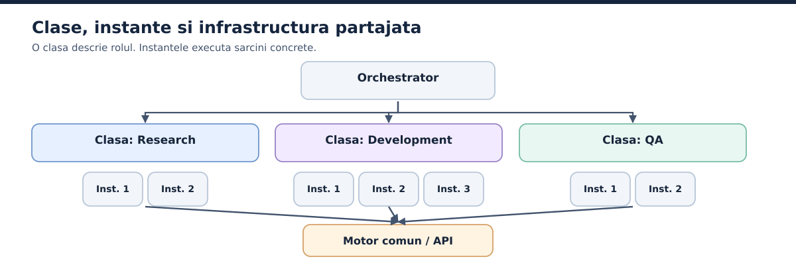

# 13. Specializare, clase si instante: impartim munca fara sa o fragmentam

## 13.1. Mai intai, ce inseamna "clasa"

In aceasta carte, **clasa de agenti** este o categorie de responsabilitati: cercetare, dezvoltare, verificare, operare, suport sau analiza. E o clasificare arhitecturala aleasa de noi, nu neaparat o clasa din vreun limbaj de programare. O clasa poate cuprinde mai multe configuratii. De pilda, clasa Development poate avea un specialist Python si unul pentru interfete web.

O **instanta** este o activare concreta a unei configuratii pentru o sarcina: `Developer-D4` modifica schema bazei de date, iar `Developer-D5` lucreaza la notificari. Pot avea acelasi set de reguli de baza, dar fiecare are nevoie de context, identificator, stare si, eventual, un spatiu de lucru propriu.

## 13.2. De ce nu facem un singur agent pentru orice

Un agent generalist poate fi foarte util la sarcini variate. Dar cand are simultan acces la toate uneltele, la toate fisierele si la istoricul complet al organizatiei, creste suprafata de risc si e mai greu de spus ce avea voie sa faca. O specializare buna reduce informatia irelevanta si permite evaluarea intr-un domeniu precis.

Specializarea nu garanteaza insa performanta. Un agent etichetat "expert in securitate" poate gresi exact ca unul generalist. Avantajul apare cand rolul e sustinut de unelte potrivite, permisiuni restranse, date relevante si criterii de verificare distincte.

## 13.3. Studiul unei functii simple

Cerinta: "Transportul este gratuit doar cand valoarea comenzii este **mai mare de** 50 de lire". Agentul de dezvoltare scrie `total >= 50`, apoi isi ruleaza testele pe valorile 30 si 70. Ambele trec. Dar pentru 50 rezultatul e gresit. Este un esec al cazurilor de test, nu neaparat al rularii lor.

Am putea crea sase agenti: unul scrie functia, unul ruleaza `pytest`, unul citeste logul, altul corecteaza, unul face commit si ultimul scrie raportul. Ar fi o fragmentare exagerata. Toate operatiile astea pot face parte din responsabilitatea fireasca a agentului de Development, iar transferurile intre sase entitati ar adauga complexitate si riscul sa se piarda informatie pe drum.

Un **agent QA separat** are sens pentru ca are alta responsabilitate: verifica implementarea fata de cerinta initiala. Poate construi teste fix la pragul de 50, poate inspecta modificarile si poate refuza acceptarea. Ideal, evaluarea lui porneste din specificatia originala si din dovezi reale, nu doar din afirmatia dezvoltatorului ca "totul e gata".

## 13.4. Ce inseamna independenta verificarii

Doua sesiuni separate nu produc o independenta perfecta. Daca folosesti acelasi model si aceleasi presupuneri, evaluatorul poate rata acelasi defect. O evaluare mai puternica adauga **oracole independente**: comparatii numerice implementate in cod, validarea schemelor, testele proiectului, date de referinta si inspectie umana pentru lucrurile greu de masurat automat.

De exemplu, un validator Python poate confirma fara echivoc ca pentru `total=50` functia returneaza un cost de transport pozitiv. Modelul de QA poate descoperi cazul relevant, dar verdictul numeric il da programul de test.

## 13.5. Specializare utila sau fragmentare excesiva?

Un rol nou se justifica daca schimba **responsabilitatea**, **setul de unelte**, **nivelul de permisiune** sau **criteriile independente de verificare**. Separarea dintre Development si QA le indeplineste de obicei. Separarea dintre "scrie functia" si "ruleaza testele aceleiasi functii" nu le indeplineste automat.

Pentru o aplicatie mare poti avea separat arhitectura, securitatea, infrastructura si conformitatea. Pentru un proiect mic pot ajunge doua roluri bine definite. Numarul potrivit nu se gaseste intr-un articol comercial; rezulta din problemele si constrangerile reale ale proiectului.

## 13.6. Clasificarile populare de agenti

Articolul Valorem Reply enumera agenti bazati pe reguli, conversationali, predictivi, colaborativi, adaptivi, RPA si cognitivi [S13](../anexe/bibliografie.md#s13). E o lista utila pentru a discuta **moduri de utilizare**, dar nu o taxonomie exclusiva. Un agent conversational poate fi si predictiv, iar un proces RPA poate apela un LLM. Un sistem cu reguli fixe poate fi automatizare deterministica, chiar daca comercial se numeste "agent AI".

Pentru proiectare propunem trei axe separate. **Rolul functional:** cercetare, implementare, suport. **Capabilitatea:** conversatie, predictie, cautare, actiune, colaborare. **Autonomia:** recomanda, pregateste, executa in sandbox, executa cu aprobare, executa in limite prestabilite. Descrierea asta te ajuta sa nu confunzi o categorie de marketing cu o proprietate tehnica.

## 13.7. Exemplu cu trei clase si mai multe instante

Putem defini clasele Research, Development si QA. Intr-un workflow, orchestratorul poate porni 2 instante Research, 3 Development si 2 QA, ca in Figura 6. Rezulta **3 clase** si **7 instante**, nu 7 modele diferite. Instantele pot folosi unul sau mai multe modele partajate si pot rula in paralel doar in masura in care sarcinile si resursele permit. La scara mai mare, acelasi principiu da, de pilda, 3 clase si 20 de instante.

*Figura 6. Clasele descriu roluri; instantele executa sarcini si pot partaja un motor de inferenta.*

Distinctia are valoare economica si operationala: actualizarile unei configuratii comune pot influenta rularile viitoare ale clasei respective, iar rezultatele se pot analiza pe responsabilitati. In acelasi timp, fiecare instanta are propria identitate in jurnal, ca sa poti reconstitui un esec concret.
