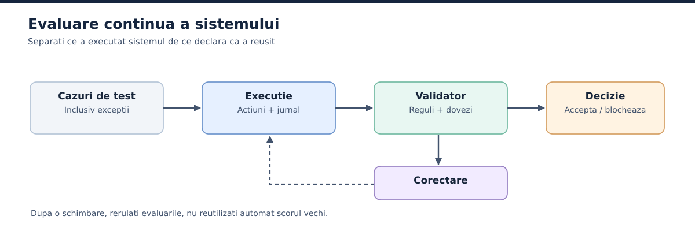

# 17. Evaluarea si Trust Score: incredere acordata treptat

Figura 8 rezuma ideea capitolului: increderea se construieste din cazuri, rulari, validari si decizii, apoi se reia dupa fiecare modificare.

*Figura 8. Increderea se construieste prin teste si dovezi, cu reevaluare dupa modificari, nu prin declaratiile de succes ale agentului.*

## 17.1. Intrebarea pe care trebuie s-o formulam corect

"Pot avea incredere in agent?" e prea larg. Incredere pentru ce? Sa explice vremea, sa editeze o ciorna, sa ruleze teste, sa schimbe o configuratie in productie? Un agent poate fi excelent la rezumate si nepotrivit pentru operatii financiare. Increderea se leaga de o **categorie de sarcini**, o **configuratie concreta**, un **nivel de autonomie** si un **set de conditii de evaluare**.

Folosim expresia **Trust Score** pentru o evaluare operationala propusa in aceasta lucrare. Nu este un standard consacrat si nu exista un scor universal care sa transforme automat 90% succes in permisiunea de a opera in productie. Scorul are sens doar impreuna cu tipul testelor, severitatea erorilor si intervalul de incertitudine.

Pentru vocabular, merita sa stii cum defineste Anthropic o evaluare: un test pentru un sistem AI in care dai o intrare si aplici o logica de notare asupra iesirii, ca sa masori succesul [S33](../anexe/bibliografie.md#s33). Ghidul lor (9 ianuarie 2026) deosebeste notarea prin cod, prin model si prin oameni, precum si evaluarile de capabilitate de cele de regresie. Primele intreaba "ce stie sa faca agentul?", celelalte "mai stie sa faca ce stia ieri?".

## 17.2. Construirea unui mediu controlat

Pornim de la agentul meteo. Ii dam o cerere fara ambiguitate, o unealta disponibila si valori de test cunoscute. Un serviciu simulat returneaza, de exemplu, pentru un oras o temperatura fixa si o ora a observatiei. Verificam daca agentul apeleaza unealta, foloseste argumentele corecte, preia valoarea si explica eventualele limite. Nu intrebam doar "a sunat bine raspunsul?".

Urmeaza cazurile diferite: localitati cu nume identice, temperaturi negative, date lipsa, raspunsuri vechi, erori HTTP, timeout, rate limit sau informatii contradictorii. Unele teste se aleg la intamplare dintr-o distributie controlata. Altele sunt **teste adversariale**, construite special pentru punctele unde agentul probabil esueaza.

## 17.3. Evaluarea progresiva

O strategie coerenta are mai multe trepte:

**Treapta A: comportament strict definit.** Agentul primeste cereri precise, o singura unealta si criterii exacte. Trebuie sa dovedeasca executia corecta.

**Treapta B: variatie controlata.** Schimbam orase, formate si valori, dar pastram un rezultat de referinta.

**Treapta C: perturbari si intreruperi.** Introducem erori, date incomplete si opriri in mijlocul procesului. Verificam daca agentul raporteaza limitele si evita actiunile gresite.

**Treapta D: sarcini mai largi.** Oferim mai multe unelte si situatii neprevazute si testam daca agentul alege corect traseul.

**Treapta E: autonomie in mediu izolat.** Relaxam constrangerile specifice scenariilor de test, dar pastram izolarea, jurnalele si regulile reale de siguranta.

**Treapta F: utilizare supravegheata.** Permitem sarcini reale cu impact limitat si cu aprobari. Observam stabilitatea pe o perioada suficienta si reevaluam dupa modificari.

Ordinea conteaza. Nu poti demonstra robustetea unui agent repetand aceeasi intrebare de o mie de ori. Variatia intrarilor si testarea erorilor sunt cel putin la fel de importante.

## 17.4. Ce verificam, concret

Pentru o sarcina operationala, evaluarea ar trebui sa separe: **corectitudinea rezultatului**, **corectitudinea apelurilor de unelte**, **respectarea regulilor**, **gestionarea erorilor**, **calitatea raportarii incertitudinii** si **consumul de resurse**. Un raspuns corect obtinut printr-un acces neautorizat nu e un succes. Un raspuns partial, care recunoaste lipsa datelor, poate fi preferabil unei afirmatii complete, dar inventate.

Poti combina mai multe tipuri de verificatori. **Validatoarele deterministe** compara valori, scheme si reguli fixe. **Evaluatorii bazati pe modele** ajuta la aprecierea calitatii textelor sau a coerentei, dar pot avea propriile erori si prejudecati. **Oamenii** revizuiesc cazurile cu miza mare, cu ambiguitati sau cu efecte care nu se pot masura automat.

Mai e o nuanta care scuteste de multe frustrari. Ghidul Anthropic observa ca, pentru a nu pedepsi inutil creativitatea, e adesea mai bine sa notezi "what the agent produced, not the path it took" [S33](../anexe/bibliografie.md#s33). Verifici rezultatul si regulile de siguranta, nu ca agentul a urmat exact traseul pe care ti l-ai imaginat tu.

## 17.5. Problema celor 90%

Sa zicem ca 90 din 100 de cereri sunt rezolvate corect. Ai o rata observata de 90% pentru setul respectiv de teste. Nu poti concluziona, fara alte informatii, ca agentul va rezolva 90% din toate cererile viitoare. Testele pot fi prea usoare, datele pot semana cu cele folosite la dezvoltare, iar cele zece esecuri pot include un incident grav.

Un rezultat din 100 de observatii are si incertitudine statistica. Un interval Wilson de 95% pentru 90 din 100 merge, aproximativ, de la 82,6% pana la 94,5%. Cu 900 din 1.000, intervalul se strange la 88,0%-91,7%. Mai multe teste dau un interval mai ingust, dar nu rezolva problema testelor nereprezentative. Daca vrei sa compari doua versiuni apropiate ca performanta, ai nevoie de esantioane mai mari si de teste comparabile.

Pentru sarcinile cu risc mare, o rata medie de succes nu ajunge. Analizeaza separat numarul de incalcari ale limitelor critice, de preferat cu toleranta foarte mica sau zero in testele de acceptare. Si aici statistica avertizeaza: zero esecuri in 200 de teste nu inseamna risc zero. Dupa "regula celor trei", limita superioara a ratei de esec este de circa 3/200, adica 1,5%, la un nivel de incredere de 95%.

O nuanta in plus vine din felul in care un agent se comporta la repetare. Ghidul Anthropic distinge `pass@k` (cel putin una din k incercari reuseste) de `pass^k` (toate cele k incercari reusesc) si arata ca cele doua spun lucruri foarte diferite pe masura ce k creste [S33](../anexe/bibliografie.md#s33). Pentru un agent care trebuie sa fie de incredere de fiecare data, a doua masura e mai apropiata de realitate.

## 17.6. Un scor compozit, doar ca instrument intern

Poti defini un tablou de evaluare cu mai multe componente, de pilda: corectitudinea finala 40%, apeluri corecte 20%, gestionarea erorilor 15%, respectarea regulilor 20% si raportarea limitelor 5%. Ponderile sunt **exclusiv un exemplu pedagogic**, nu o formula recomandata universal. In productie le stabilesti prin analiza riscului, iar unele defecte trebuie sa fie conditii eliminatorii, nu simple penalizari.

O greseala de formatare poate scadea scorul usor. O plata neautorizata trebuie sa blocheze promovarea, chiar daca alte 999 de teste au trecut. Un scor unic, fara istoricul defectelor, ascunde tocmai informatia de care ai nevoie.

## 17.7. Trei niveluri de evaluare

**La nivel de run**, intrebi daca executia concreta a indeplinit criteriile. **La nivel de clasa**, masori cum se comporta o configuratie de agenti pe o colectie de sarcini. **La nivel de sistem**, verifici daca orchestratorul a transmis corect informatiile, a gestionat dependentele, a impus permisiunile si a integrat rezultatele. Un model bun poate face parte dintr-un sistem prost orchestrat. Invers, o arhitectura buna nu poate garanta succesul unui agent nepotrivit.

## 17.8. Teste ascunse, perturbari aleatorii si reevaluare

Pe langa testele folosite in timpul dezvoltarii, ai nevoie de un set de evaluare pastrat separat. Altfel poti adapta promptul exact la cazurile cunoscute si supraestimezi performanta. Testele aleatorii se genereaza din clase realiste de situatii, nu doar schimband cateva cuvinte. Intreruperile, raspunsurile invalide si datele incomplete sunt foarte utile pentru evaluarea mecanismelor failsafe.

Dupa o modificare a modelului, promptului, uneltelor, bazei de documente sau regulilor de orchestrare, evaluarea relevanta se repeta. Increderea nu e o diploma permanenta. E o concluzie conditionata de versiunea si conditiile sistemului.

## 17.9. Ce inseamna "human-in-the-loop" in practica

Un operator poate aproba o plata, poate revizui o concluzie ambigua sau poate confirma o modificare in productie. Dar existenta unui buton de aprobare nu garanteaza nimic daca omul nu primeste contextul necesar. O aprobare buna arata ce se va schimba, de ce, pe baza caror date, ce verificari au trecut si cum se poate reveni. La sarcinile repetitive cu risc mic, verificarile automate se scaleaza mai bine. La exceptii si consecinte importante, interventia umana ramane esentiala.

## 17.10. Legatura cu gestionarea riscului

NIST trateaza gestionarea riscului AI ca pe un proces care include guvernare, intelegerea contextului, masurare si gestionare continua [S15](../anexe/bibliografie.md#s15). Nu scoatem din abordarea asta un "scor NIST" inventat. O folosim ca principiu: masurarea are valoare doar daca este legata de decizii operationale si de responsabilitati clare.
